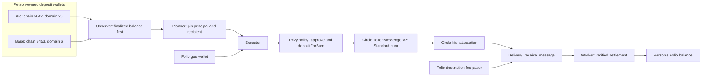
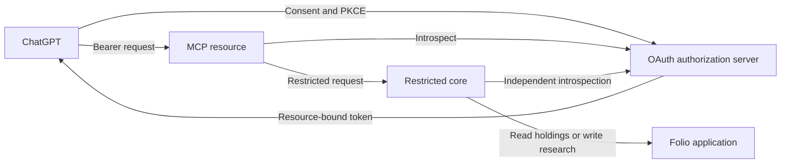

# Architecture

Deposit authority is limited to moving funds into the person's own Folio account.\
Folio pays source gas and destination delivery costs, then credits only verified settlement.\
The ChatGPT connection has separate read/research permissions and no wallet-signing authority.

## Funding

The transfer settles into the person's Folio account (a Solana USDC account; CCTP domain 5).

The person owns the embedded EVM wallet. Folio is an additional signer constrained by that person's chain-specific deposit policy. Approval targets the source USDC token and Circle messenger; the burn pins the token, destination domain, and person's recipient.

The observer reads the finalized head and wallet balance before fetching attribution logs. The planner pins the amount and recipient. Arc accounting keeps customer principal and Folio's gas contribution separate at 18-decimal precision.

The executor tops up gas from Folio's wallet and signs through Privy. The burn uses Standard Transfer with `maxFee = 0`, `minFinalityThreshold = 2000`, unrestricted destination caller, and no hooks. Both routes require reviewed deployment evidence; Arc also checks the amount-specific fee getter before execution.

Circle Iris supplies the attestation. Folio submits destination delivery with its own fee payer. A verified finalized receipt allows the durable transfer to enter `settled`; the credit operation is replayable after a crash. Attestation or submission alone does not make funds available.

## Agent connection

The authorization server, MCP resource, and restricted core enforce separate trust boundaries. ChatGPT holds no wallet credentials; MCP has no signing authority. The core verifies identity, scope, and connection policy before application access.

The hosted connection writes research in Paper, Folio's simulated investing environment, without access to live account data. Its private Folio-server adapter and production deployment configuration are outside this repository. See [connector hardening](connector-hardening.md).

## Circle tool map

| Concern | Source |
|---|---|
| Source chain IDs, CCTP domains, and token addresses | [source-registry.ts](../bridge/src/bridge/source-registry.ts) |
| Standard approval and burn calls | [source-calls.ts](../bridge/src/bridge/source-calls.ts) |
| Attestation polling and message validation | [attestation.ts](../bridge/src/bridge/attestation.ts), [message.ts](../bridge/src/bridge/message.ts) |
| Destination receive and settlement | [delivery.ts](../bridge/src/bridge/delivery.ts), [worker.ts](../bridge/src/bridge/worker.ts) |
| Arc principal and gas accounting | [source-gas.ts](../bridge/src/bridge/source-gas.ts) |
| Per-person source policy | [evm-sweep-policy.ts](../wallet/src/evm-sweep-policy.ts) |
| Pinned zero-fee deployment evidence | [fee-proof.md](fee-proof.md) |

[Bridge operation](bridge.md) describes runtime gates; the [transfer contract](transfer-contract.md) describes durable records and recovery.
